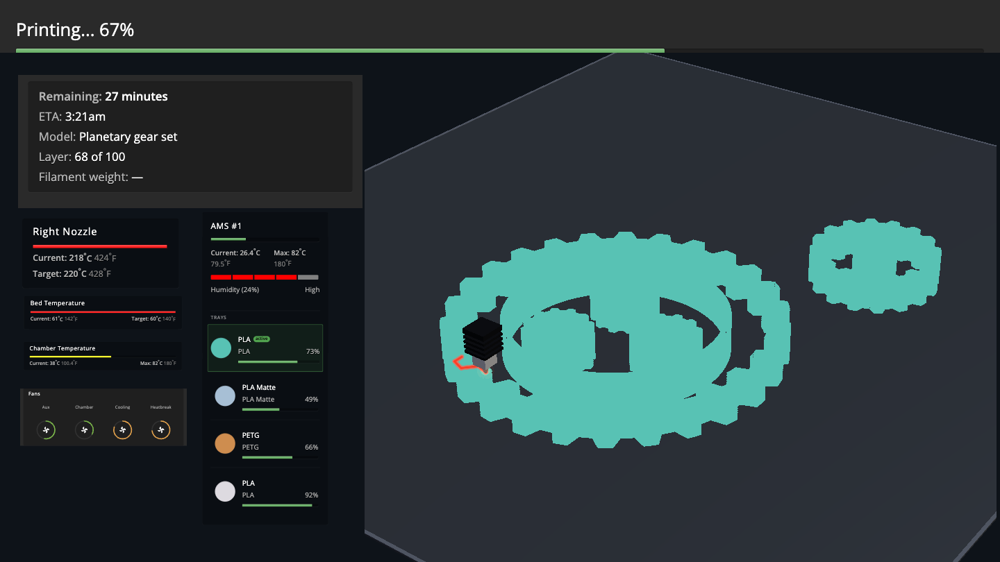
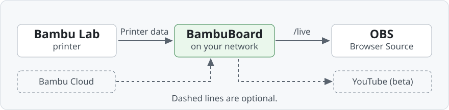
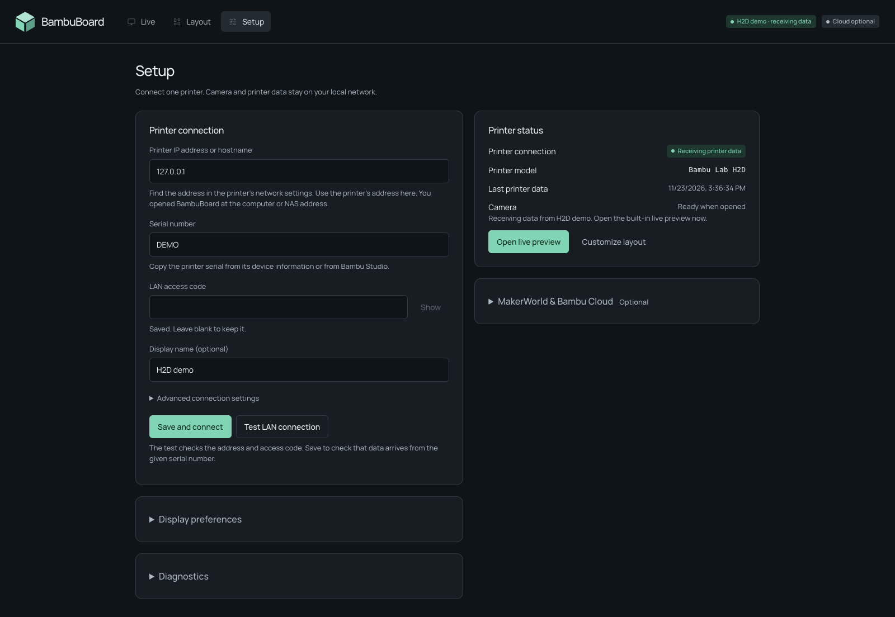
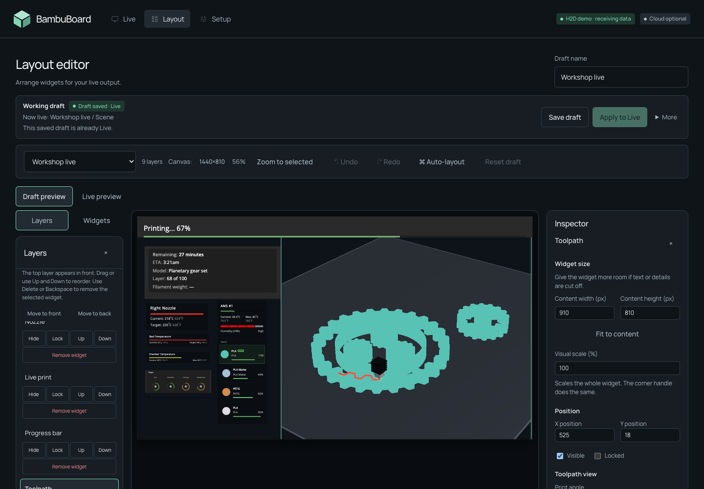

<div align="center">


# BambuBoard

**Turn your Bambu Lab printer into a live stream overlay.**

Camera, temperatures, AMS and print progress in a single OBS Browser Source.<br>
Runs on your own network. No cloud account required for core features.

<br>

[](https://github.com/t0nyz0/BambuBoard/releases)
[](LICENSE)
[](https://github.com/t0nyz0/BambuBoard/pkgs/container/bambuboard)
[](https://github.com/t0nyz0/BambuBoard/actions/workflows/docker-publish.yml)
[](.github/workflows/validate.yml)
[](https://github.com/t0nyz0/BambuBoard/stargazers)

[Quickstart](#quickstart) · [Install](#install-bambuboard) · [Supported printers](#supported-printers) · [Widgets](#widget-catalog) · [Troubleshooting](#troubleshooting) · [FAQ](#faq) · [What's new](https://github.com/t0nyz0/BambuBoard/releases)

<a href="screenshots/STUDIO-OUTPUT.png"></a>

<sub>The <code>/live</code> output during a demo H2D print. This is what your viewers see.</sub>

</div>

## What you get

- 🎥 **Camera and data in one source.** Add one OBS Browser Source for the whole overlay.
- 🧩 **20 widgets.** Show print progress, temperatures, fans, AMS trays and drying status, a G-code toolpath, and more.
- 🖱️ **Drag-and-drop editor.** Move, resize, and style widgets. Save a draft without touching the live view, then apply it when it’s ready.
- 🏠 **Runs on your LAN.** Core telemetry, camera, and toolpath features don’t require cloud sign-in.
- 📺 **Stream straight to YouTube (beta).** Send the overlay from BambuBoard without OBS. [Requirements and limitations](docs/youtube-streaming.md).



## Quickstart

### Install BambuBoard

Run BambuBoard on a computer or NAS that can reach your printer. Docker images support `linux/amd64` and `linux/arm64`.

| Where BambuBoard runs | How to install |
| --- | --- |
| Windows, Mac, or Linux computer | [Docker Desktop or Docker Engine](#docker-on-a-computer) |
| Synology NAS | [Container Manager](#synology-nas-container-manager) |
| QNAP, Portainer, or TrueNAS | [Paste a Compose file](#qnap-portainer-and-truenas) |
| Development or custom installation | [Run from source](#from-source) |

#### Docker on a computer

Start Docker Desktop on Windows or Mac. On Linux, start Docker Desktop or Docker Engine. [Docker Desktop installation](https://docs.docker.com/desktop/)

Open Terminal or PowerShell and run:

```text
docker run -d --name bambuboard --restart unless-stopped -p 8080:8080 -v bambuboard-data:/usr/src/app/data ghcr.io/t0nyz0/bambuboard:latest
```

Open `http://localhost:8080` on the Docker host, or `http://<host-ip>:8080` from another machine. Setup opens automatically on a new install. The named volume keeps settings and layouts. If 8080 is already in use, change `8080:8080` to `18080:8080` and open port 18080.

### Setup, layout and OBS

1. In **Setup**, enter the printer’s **IP address**, **serial number**, and **LAN access code** from the printer settings or Bambu Studio. Choose **Save and connect**.
2. When printer data arrives, choose **Open live preview**. The built-in layout is ready to use. Choose **Customize layout** if you want to make changes. Use **Apply to Live** when your draft is ready.
3. Under **Use in OBS**, choose **Copy Browser Source URL**. Add a Browser Source in OBS and use the width and height shown next to it. You can also choose **Download an OBS scene** and import it from **Scene Collection → Import**.

> [!TIP]
> If OBS runs on another machine, use the BambuBoard host address instead of `localhost`. Use `/live?transparent=1` for a transparent page background.

### Screenshots

<table>
  <tr>
    <td width="50%" valign="top"><strong>Setup</strong><br><a href="screenshots/STUDIO-SETUP.png"></a></td>
    <td width="50%" valign="top"><strong>Layout editor</strong><br><a href="screenshots/STUDIO-LAYOUT.png"></a></td>
  </tr>
</table>

Screenshots show BambuBoard 3.3.4 with demo printer data. [See the G-code connection check under Setup → Diagnostics](screenshots/STUDIO-SETUP-GCODE.png) · [Live workspace](screenshots/STUDIO-LIVE.png) · [Mobile](screenshots/STUDIO-MOBILE.png).

### Other ways to install

<details>
<summary><strong>Synology NAS, QNAP, Portainer, and TrueNAS</strong></summary>

### Synology NAS (Container Manager)

For a new install on DSM 7.2 or later, check that your NAS model supports [Synology Container Manager](https://www.synology.com/en-us/dsm/packages/ContainerManager).

Docker Hub also lists the public image as **t0nyz/bambuboard**. [Docker Hub listing](https://hub.docker.com/r/t0nyz/bambuboard)

1. Install **Container Manager** from **Package Center**.
2. Open **Container Manager → Project → Create**, name the project `bambuboard`, and choose a project folder. Paste this Compose file in the editor, or save it as `docker-compose.yml` and upload it. [Synology Project guide](https://kb.synology.com/en-global/DSM/help/ContainerManager/docker_project)

   ```yaml
   services:
     bambuboard:
       image: ghcr.io/t0nyz0/bambuboard:latest
       restart: unless-stopped
       ports:
         - "8080:8080"
       volumes:
         - bambuboard-data:/usr/src/app/data

   volumes:
     bambuboard-data:
   ```

3. Finish the wizard, start the project, and open `http://<your-nas-ip>:8080`. [Connect your printer](#setup-layout-and-obs).

The named volume keeps settings, scenes and cached files across container updates. If port 8080 is already in use on the NAS, change the left-hand port in `8080:8080` and open that port in your browser. [Synology bind mounts and terminal installs](#synology-bind-mounts-and-terminal-installs).

### QNAP, Portainer and TrueNAS

Use the same Compose file for a new installation. Keep the named data volume when updating.

- **QNAP Container Station** — Paste it under **Applications → Create**. Use `18080:8080` because QTS commonly uses port 8080 for NAS management, then open `http://<your-nas-ip>:18080`. [Container Station setup](https://www.qnap.com/en/how-to/tutorial/article/how-to-use-container-station-3) · [QNAP system ports](https://www.qnap.com/en-uk/how-to/faq/article/what-network-ports-are-used-by-qts-quts-hero-and-qutscloud-systems)
- **Portainer** — Paste it in **Stacks → Add stack → Web editor**. [Portainer stack setup](https://docs.portainer.io/user/docker/stacks/add)
- **TrueNAS** — From **Apps → Discover**, open the menu and choose **Install via YAML** on a version that supports Docker apps. [TrueNAS custom app setup](https://apps.truenas.com/managing-apps/installing-custom-apps/)

</details>

<details>
<summary><strong>Docker Compose</strong></summary>

[`docker-compose.yml`](docker-compose.yml) is an alternative for a repository checkout and builds the image locally. Run `docker compose up -d` and configure the printer in Setup. To pick up base-image and OS security updates when rebuilding locally, run `docker compose build --pull --no-cache` before `docker compose up -d`. Explicit `BAMBUBOARD_*` environment overrides take precedence over saved values when the app starts. Keep the included `OBS_settings` directory when using its template mount.

</details>

<details>
<summary><strong>From source (Node.js 24)</strong></summary>

### From source

Use **Node.js 24** (see [`.nvmrc`](.nvmrc)) and **npm 11 or newer**. Install a maintained system FFmpeg for RTSPS cameras and direct YouTube streaming. For example, run `sudo apt-get update && sudo apt-get install -y ffmpeg` on Debian or Ubuntu, or `brew install ffmpeg` on macOS. On Windows, use a current Windows build listed on the [FFmpeg download page](https://ffmpeg.org/download.html).

Check `ffmpeg -version`. BambuBoard uses the `ffmpeg` executable on `PATH`. To choose a different one, set `FFMPEG_BIN` to the executable path in the terminal or service that starts BambuBoard.

With Node.js and npm ready, install and start BambuBoard.

```bash
git clone https://github.com/t0nyz0/BambuBoard.git
cd BambuBoard
npm ci
npm start
```

Open **http://localhost:8080**. Docker includes FFmpeg and Chromium. Server YouTube capture also needs Chromium or Chrome on source installs. [Streaming setup](docs/youtube-streaming.md#requirements)

</details>

<details>
<summary><strong>Layout and OBS tips</strong></summary>

If a widget's details are cut off, select it and choose **Fit to content**. **Content width** and **Content height** change how much room its content has. **Visual scale** changes how large the whole widget appears.

Select **Gcode Toolpath**. Under **Toolpath view**, use **Print angle** and **Print zoom**. Set zoom to 100% to fit the print. These choices are saved with the draft and appear in OBS after **Apply to Live**. You can also change angle and zoom temporarily from the standalone toolpath preview.

**`/live` is the broadcast output; `/` is the management page.** The broadcast renders the published snapshot, falling back to a matching default template before the first publication. Re-publish to update it automatically. If OBS runs on another machine, use the BambuBoard host's address rather than `localhost`.

Match the Browser Source dimensions and OBS **Settings → Video → Base (Canvas) Resolution** to the published scene size shown under Live preview. The OBS download includes that size, including custom resolutions. A differently sized browser viewport scales the scene to fit and may letterbox. Use `/live?transparent=1` to make the page background transparent; individual widget and scene backgrounds still apply.

Default templates are layout starters in [`OBS_settings/templates`](OBS_settings/templates): `default-x1` for single-nozzle layouts and `default-h2d` for the H2D-class dual layout. The editor chooses by detected type and falls back to `default-x1`. Customize the starter to match your actual hardware, including its AMS selection.

</details>

### Updating

Back up and reuse your existing data mount. Pull the new image and recreate the container with the same settings. [Upgrade and data migration instructions](#upgrading-an-existing-docker-installation) · [3.3.4 release notes](docs/release-notes-3.3.4.md)

## Supported printers

Detection matches MQTT product names, then falls back to hardware/project identifiers. The [capability map](src/lib/caps.js), based on [ha-bambulab](https://github.com/greghesp/ha-bambulab), controls widget availability and camera transport.

The maintainer owns and tests **X1 Carbon and H2D**. Other entries are code mappings that need community hardware feedback; a recognized model does not establish that every widget works on its firmware. The current G-code changes have a read-only physical H2D download and local rendering check; affected H2C firmware and actual OBS still need confirmation. See the [QA record](docs/qa-studio-refresh.md) and [G-code verification](docs/gcode-resilience.md#verification) for the scope of testing.

| Printer | BambuBoard type | Current coverage |
|---|---|---|
| X1 Carbon | `X1C` | Maintainer-tested hardware |
| H2D | `H2D` | Maintainer-tested hardware |
| H3C | `H3C` | Dedicated profile tested with fixtures. Hardware verification pending. |
| X1 | `X1` | Dedicated capability entry; community feedback welcome |
| P1P / P1S | `P1P` / `P1S` | Dedicated capability entries; community feedback welcome |
| P2S | `P2S` | Dedicated capability entry; community feedback welcome |
| A1 / A1 Mini | `A1` / `A1M` | Dedicated capability entries; community feedback welcome |
| X1E | `X1C` | Shared fallback; no dedicated X1E capability entry |
| H2D Pro / H2C / H2S / X2D | `H2D` | Shared fallback; no dedicated capability entries |

Fallback mappings reuse another model's widget gates and build dimensions. They can differ from the actual hardware, so check the selected widgets and layout rather than assuming all H2D features apply.

**AMS selection:** the widget automatically selects the integrated AMS 3H or the only reported AMS. On a classic multi-AMS setup it keeps the existing index **1** default used by the H2D starter. Use `?ams=N` to select a different array index in `print.ams.ams`, starting at 0. Telemetry indexes can differ from the labels on your units.

### H3C compatibility

The **H3C** has a dedicated model profile and a 330 × 320 × 325 mm Toolpath bed. Use normal LAN connection details in Setup. For the camera, enable **LAN Only Liveview** on the printer. BambuBoard uses the RTSP endpoint announced by the printer. [Bambu Lab's H3C specifications](https://blog.bambulab.com/tool-changer-game-changer-bambu-lab-presents-h3c-the-defining-new-generation-of-3d-printers/#h3c-technical-specification) · [ha-bambulab camera notes](https://github.com/greghesp/ha-bambulab/blob/7c740224c72401890ac9744643aa1b0c73e732f4/README.md#camera)

The **AMS** widget displays the integrated AMS 3H’s nine trays and both zones' reported temperature and humidity. The drying countdown uses the heated zone. The **Gcode Toolpath** widget retrieves the active sliced file over FTPS when the printer makes it available. For jobs stored internally or otherwise unavailable over FTPS, use **Load sliced file** with the exact `.3mf` or `.gcode`.

H3C hardware verification is pending. The first live check should confirm detection after a restart, the chamber feed with OBS, automatic retrieval for LAN and cloud jobs, and tray, color, and drying-zone changes on an actual AMS 3H during a multi-material print.

## Widget catalog

Each widget is a standalone page at `/widgets/<slug>/`. Add it in the Layout editor to include it in `/live`, or use its URL as an individual OBS Browser Source. Availability is based on the detected type; capability-gated widgets are disabled in the editor for incompatible types.

| Widget | What viewers see |
|---|---|
| **Camera** | The printer’s live camera |
| **Progress / Print info** | Print status, percentage, remaining time, and layers |
| **Temperatures / Fans** | Nozzle, bed, and chamber temperatures, plus available fan readings |
| **AMS** | Filament trays, colors, humidity, and reported drying status |
| **Gcode Toolpath** | A 3D preview with estimated nozzle motion and a colored cooling trail behind fresh extrusion. [File access and limits](docs/gcode-resilience.md) |
| **Model image / MakerWorld profile** | Model image and profile stats, with optional Bambu Cloud sign-in |

<details>
<summary><strong>Full catalog: all 20 widgets, sizes, and options</strong></summary>

<!-- WIDGET-CATALOG-START -->
| Widget | Description | Recommended size | Params | Cap-gated |
|--------|-------------|------------------|--------|-----------|
| **AMS** (`ams`) | Filament trays, active slot, temperature, humidity and drying status. Selects the integrated AMS 3H or the only reported unit automatically, and uses index 1 for classic multi-AMS layouts. Use ?ams=N to choose a telemetry array entry. | 400×460 | `?ams` | — |
| **AMS humidity / temp (legacy)** (`ams-temp`) | Legacy standalone AMS humidity, temperature and reported drying status. These readouts are also included in `ams`. | 400×120 | — | — |
| **AMS #2 humidity (legacy)** (`ams-temp-2`) | Legacy companion AMS humidity, temperature and reported drying status. These readouts are also included in `ams2`. | 400×120 | — | `hasDualAMS` |
| **AMS #2** (`ams2`) | Legacy companion AMS card for H2D-class layouts. Shows temperature, humidity, reported drying status and four trays from telemetry array entry 0. Use the configurable `ams` widget to select other entries. | 400×460 | — | `hasDualAMS` |
| **Bed temperature** (`bed-temp`) | Heat-bed temp with target + progress bar. | 400×120 | — | — |
| **Live camera** (`camera`) | Printer camera relayed into the browser. Selects RTSP or the chamber-image transport from the detected printer type. Requires reachable LAN camera access; RTSP liveview must be enabled on the printer. | 640×360 | — | — |
| **Chamber temperature** (`chamber-temp`) | Reported chamber temperature, shown for printer types with the chamber-temperature capability. | 400×120 | — | `hasChamberTemp` |
| **Fans** (`fans`) | Auxiliary, chamber, cooling and heatbreak fan gauges from reported telemetry. Available readings depend on the printer. | 420×160 | — | — |
| **Gcode Toolpath** (`gcode-viz`) | Experimental 3D toolpath from the current print's sliced G-code, downloaded over FTPS or loaded manually. Uses reported layers/progress and estimated timing, with bounded retries and downloadable diagnostics. Requires WebGL 2; simulated nozzle motion can drift. | 640×640 | — | — |
| **Model image** (`model-image`) | Preview image of the current model (requires Bambu Cloud auth for live MakerWorld images). | 400×300 | — | — |
| **Notes / footer** (`notes`) | Auto-updates with the model name each print; supports a manual text override (via the /api/note endpoint). | 600×40 | — | — |
| **Nozzle info** (`nozzle-info`) | Nozzle type, size, current speed level. | 400×120 | — | — |
| **Nozzle temperature** (`nozzle-temp`) | Nozzle temperature with current/target and progress bar. Use ?nozzle=0 (right, default) or ?nozzle=1 (left) for dual-nozzle printers. | 400×120 | `?nozzle=0` | — |
| **Left nozzle temperature** (`nozzle-temp-2`) | Left nozzle temperature (H2D/dual-nozzle). Legacy widget — equivalent to nozzle-temp/?nozzle=1. | 400×120 | — | `hasDualNozzle` |
| **Print info** (`print-info`) | Remaining time, estimated finish time, model name and layer count from telemetry. Filament weight is populated from Bambu Cloud when available. | 400×160 | — | — |
| **Printer info** (`printer-info`) | Nozzle type/size and print speed from telemetry, plus printer name, model, bed type and recent print count when Bambu Cloud data is available. | 400×140 | — | — |
| **MakerWorld profile** (`profile-info`) | Followers, downloads, and stats from your MakerWorld profile (requires Bambu Cloud auth). | 400×180 | — | — |
| **Progress** (`progress-info`) | Print progress bar with status text and percentage. | 600×80 | — | — |
| **Version stamp** (`version`) | Shows BambuBoard version in a corner. | 200×30 | — | — |
| **Wi-Fi signal** (`wifi`) | Wireless signal strength. | 200×80 | — | — |

_20 widgets — generated by `scripts/build-widget-catalog.js`._
<!-- WIDGET-CATALOG-END -->

</details>

<details>
<summary><strong>Customize standalone widget URLs</strong></summary>

The shared customizer accepts these parameters. Appearance depends on the widget: title overrides require a title element, and full-frame camera/G-code widgets manage their own backgrounds.

| Parameter | Meaning |
|---|---|
| `theme=dark`, `light` or `transparent` | Widget color scheme |
| `accent=51a34f` | Hex accent color **without `#`** |
| `fontSize=14` | Base font size in pixels |
| `title=My%20title` | Override an existing widget title |
| `pad=8` | Body padding in pixels, clamped to 0–64 |

Combine parameters with `&`, for example `/widgets/ams/?ams=0&theme=dark&accent=51a34f`. Widget-specific parameters are listed in the catalog. Saved widget themes are independent of the management app's theme.

For a standalone G-code browser source, add `view=angled`, `top`, `front`, or `side`, plus an optional `zoom` value from 50 to 200. For example, `/widgets/gcode-viz/?view=top&zoom=125`.

</details>

## Optional extras

- **Bambu Cloud:** Adds MakerWorld model images, profile stats, filament weight, and some printer details. [Sign-in instructions](docs/bambu-cloud.md).
- **YouTube streaming (beta):** Stream the overlay directly from the Live page with server capture or browser tab sharing. [Setup and limits](docs/youtube-streaming.md).

## Configuration

<details>
<summary><strong>Network ports, credentials, and reverse proxies</strong></summary>

Allow the BambuBoard host to reach the printer on the ports used by your features:

| Feature | Printer connection |
|---|---|
| Telemetry | TLS MQTT, **8883** by default; configurable in Setup |
| RTSP camera | RTSPS, normally **322** for X1/X1C/H2D/P2S/H3C. H3C follows the port reported by the printer. |
| Chamber-image camera | TLS image stream, **6000** for P1/A1-class types |
| G-code download | Implicit TLS FTPS, **990**, plus the printer's negotiated passive data ports |

The viewer/OBS connects to BambuBoard on **8080** by default. MQTT success alone does not verify camera or file access. The Docker Quickstart examples publish port 8080 through Docker's bridge network. The Synology terminal installs above use host networking. Cloud widgets need internet access; YouTube streaming uses outbound encrypted RTMPS on **443**. App assets have no CDN dependency, though custom remote sources and cloud content can still make external requests.

Saved printer credentials and Bambu Cloud tokens stay on the server. Leave the access code blank to keep the saved code for the same printer connection, or enter a fresh code to change that connection. If the proxy rewrites the request Host header, set `BAMBUBOARD_PUBLIC_URL` to the public browser address.

</details>

Most settings are in the Setup page. [Environment and source configuration](docs/development.md#development).

> [!WARNING]
> BambuBoard has no app login. Keep it on a trusted network or put it behind a reverse proxy with authentication.

## Troubleshooting

<details>
<summary><strong>Connection test fails or widgets have no data</strong></summary>

Check the printer IP, serial number, access code, and MQTT port. Use **Printer status** in Setup to see whether data is arriving. To investigate, enable **Verbose logging** under **Diagnostics**, save it, then check `docker logs bambuboard` or the source server’s terminal.

</details>

<details>
<summary><strong>Wrong printer type</strong></summary>

Check the detected model on Setup and [current mappings](src/lib/caps.js). `BAMBUBOARD_PRINTER_TYPE` supplies the startup type; MQTT auto-detection can replace it. Report a mismatched model with its MQTT module information rather than relying on the environment variable to force a permanent override.

</details>

<details>
<summary><strong>Camera is black or unavailable</strong></summary>

Check camera status separately from MQTT. On RTSP models, enable the printer's LAN liveview option where available and follow the widget's hint; menu names and firmware requirements vary. Verify port 322 and the server's FFmpeg relay. P1/A1-class types use port 6000 and the LAN access code instead.

</details>

<details>
<summary><strong>OBS shows nothing</strong></summary>

Open the copied **Browser Source URL** in a browser on the OBS machine to confirm that it can reach BambuBoard. Match the source width and height to the Live page. The built-in layout works before you publish a custom layout.

</details>

<details>
<summary><strong>AMS unit unavailable</strong></summary>

Check `print.ams.ams` in `/data.json` and choose a reported array index. Clear an explicit `ams` parameter to use automatic selection.

</details>

<details>
<summary><strong>G-code cannot load</strong></summary>

Choose **Open toolpath preview** on Live. Check printer file access under **Setup → Diagnostics → Test G-code connection**. The standalone preview offers **Retry now**, **Download diagnostics**, and **Load sliced file** when applicable. Use the exact sliced `.3mf` or `.gcode` for the current print. [G-code troubleshooting and limits](docs/gcode-resilience.md)

</details>

## FAQ

<details>
<summary><strong>Do I need a Bambu Cloud account?</strong></summary>

No. Core telemetry, the camera, and FTPS toolpaths use your printer’s LAN connection. Cloud sign-in adds MakerWorld content and some additional print details.

</details>

<details>
<summary><strong>Can BambuBoard control my printer?</strong></summary>

It reads printer data for your overlay. You can’t start or stop a print from BambuBoard.

</details>

<details>
<summary><strong>Can I show more than one printer?</strong></summary>

Run one BambuBoard instance per printer, with a separate port and data volume for each.

</details>

<details>
<summary><strong>Do I need OBS?</strong></summary>

No. Open `/live` in a browser or another streaming tool that accepts a URL. The optional YouTube beta can also stream without OBS.

</details>

## Upgrading an existing Docker installation

<details>
<summary><strong>Existing volumes, ownership, and Synology terminal installs</strong></summary>

Since 3.3.2, BambuBoard runs as UID and GID `1000:1000` by default and reports its health using its local HTTP listener. A new named volume works with the default user. Keep your current volume when upgrading.

- For an existing writable mount, upgrade with the same mount. If the owner is a different non-root UID and GID, you can keep that ownership by setting Docker `--user UID:GID` or Compose `user: "UID:GID"`. The runtime user needs read and write access to BambuBoard's files and directories.
- If an older root-run container owns the data, stop the old container and back up its data. Pull the new image, then run this one-time command. Replace `/absolute/path/to/current-data` with the actual bind path or existing Docker volume name.

  ```bash
  docker run --rm --network none --user 0:0 \
    -v "/absolute/path/to/current-data:/usr/src/app/data" \
    ghcr.io/t0nyz0/bambuboard:latest node scripts/docker-migrate-data.js
  ```

  For Compose, build or pull the updated image and use the same service and file as your installation. For the Synology file, insert `-f docker-compose.synology.yml` before `run`.

  ```bash
  docker compose run --rm --no-deps --user 0:0 bambuboard node scripts/docker-migrate-data.js
  ```

  The command can also prepare a new bind mount created by Docker for Compose. It updates ownership and owner permissions of BambuBoard data and leaves the contents and unrelated files alone. Start the updated container with its default user after the command succeeds. The install/update scripts perform this step for their own data mount when required. If a NAS or network share restricts ownership changes, set permissions on the host or use the mount's existing non-root UID and GID.

### Synology bind mounts and terminal installs

The [Synology Compose file](docker-compose.synology.yml) pulls the published image, uses host networking and mounts `~/bambuboard-data`. Save the file on your NAS, then follow the [Compose data preparation steps](#upgrading-an-existing-docker-installation) before starting a new bind mount or upgrading older root-owned data.

```bash
docker compose -f docker-compose.synology.yml pull
docker compose -f docker-compose.synology.yml up -d
```

Alternatively, use the [install/update script](update-synology.sh):

```bash
curl -O https://raw.githubusercontent.com/t0nyz0/BambuBoard/main/update-synology.sh
chmod +x update-synology.sh
./update-synology.sh
```

The script elevates with `sudo`, pulls `latest` and replaces the `bambuboard` container. Its bind mount is `$HOME/bambuboard-data` **after elevation**, usually `/root/bambuboard-data`; it prints the actual path. Compose resolves `~` from the account running Compose. For an existing installation, retain its current data mount when choosing either method so your settings and scenes carry over. Open **http://<your-nas-ip>:8080**.

</details>

<details>
<summary><strong>Migrating from older versions</strong></summary>

**v3 is single-printer.** If you need the older multi-printer app, the [`v2.0.1` source tag](https://github.com/t0nyz0/BambuBoard/tree/v2.0.1) remains available.

On first boot, legacy flat H2D settings are converted to the `printer` object. For a legacy `printers[]` array, migration keeps the **first entry with a non-placeholder serial number** (or the first entry if none qualifies), warns in the server log and removes other printers from the active configuration. A backup of the original is stored in `data/config.json.pre-merge-<reason>-<timestamp>.bak` before conversion.

With the default data directory, legacy root-level `config.json`, `accessToken.json`, `note.json` and `public/data.json` are moved into `data` when their destinations do not already exist. An explicit `BAMBUBOARD_DATA_DIR` disables that root-file migration. Back up the whole persistent data directory before upgrading.

</details>

## Contributing

[Issues](https://github.com/t0nyz0/BambuBoard/issues) and pull requests are welcome, especially hardware feedback for additional printer models. Include the model, firmware, app version, a screenshot and the relevant telemetry fields. For toolpath failures, attach **Download diagnostics** output; it redacts connection secrets. Review anything you share for private filenames, account data or credentials. See the [development guide](docs/development.md) for the source layout and test commands.

## Acknowledgements and license

Thanks to [ha-bambulab](https://github.com/greghesp/ha-bambulab) for protocol/detection work, [Bambu Lab](https://bambulab.com/) for the printers, and [OBS Studio](https://obsproject.com/) for browser sources. [G-code research credits](docs/gcode-resilience.md#protocol-and-storage-research) link the additional source projects used for file-transfer improvements.

[MIT](LICENSE) © [t0nyz0](https://github.com/t0nyz0)
